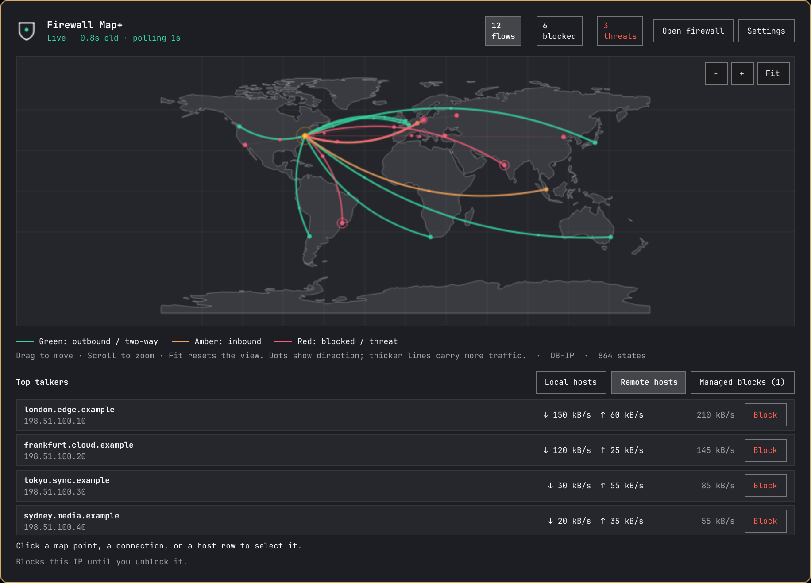
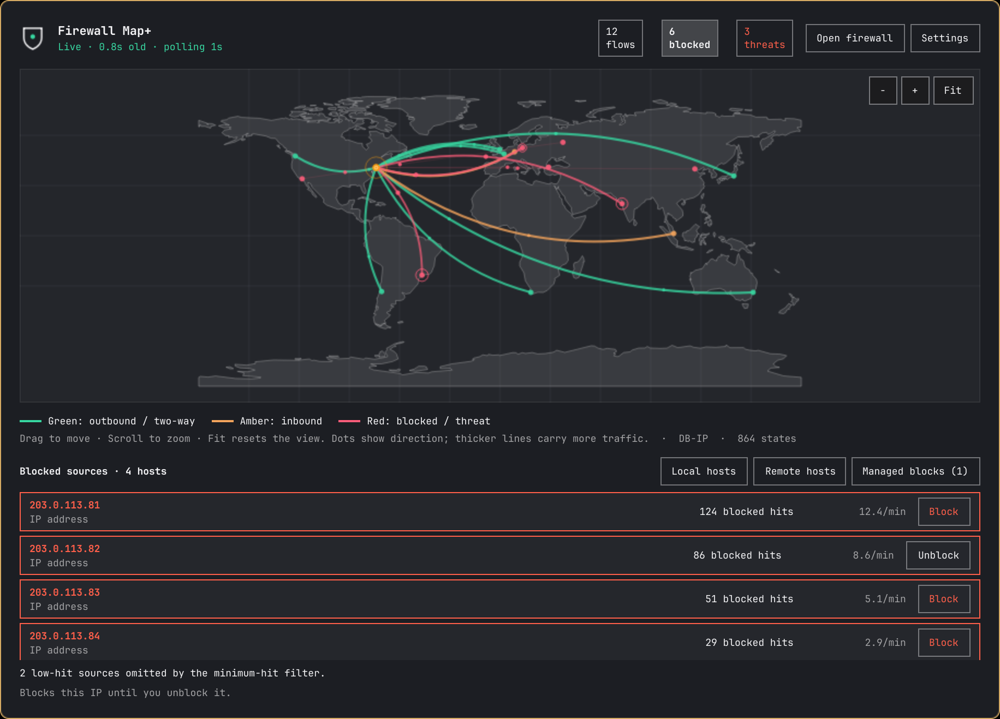
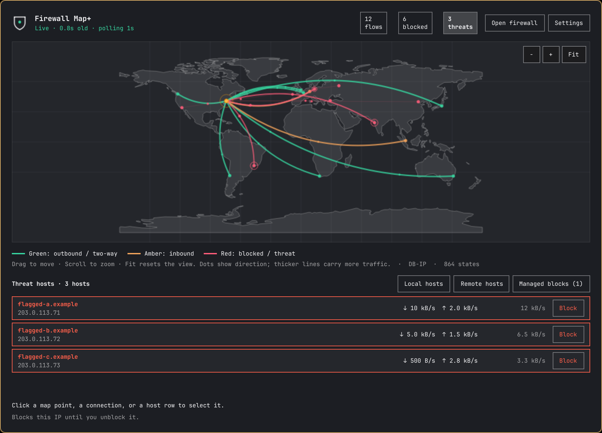

<div align="center">

# Firewall Map+ for Omarchy

**Your OPNsense traffic. A world map. Right in the bar.**

[](https://github.com/jblparisi/omarchy-firewall-map/releases)
[](https://omarchy.org/)
[](LICENSE)

[Install](#install) · [Requirements](#requirements) · [Set up OPNsense](docs/requirements.md) · [Screenshots](#screenshots)



</div>

A native Omarchy bar widget for **OPNsense + Firewall Map+**. See live traffic,
inspect blocked sources and flagged hosts, and block or unblock an IP from its
row. Drag the map, zoom into a region, or fit the whole world back into view.

The screenshots use fictional hostnames and documentation IP ranges.

## Requirements

You need **both sides** of the setup:

| Where | Required |
| --- | --- |
| Firewall | An **OPNsense** installation supported by the upstream Firewall Map+ package |
| OPNsense module | **Firewall Map+**, package **`os-firewall-map`**, from [Claudio Guareschi's Dashboard Plus repository](https://github.com/claudioguareschi/opnsense-dashboard-plus#install), with a working collector and geolocation data |
| Desktop | **Omarchy with its native Quickshell shell** and `omarchy plugin` commands; validated on Omarchy 4.5.0rc3 |
| Local dependencies | **Python 3** (standard library only), **iproute2** (`ip`, used for host-block checks), and **Git** for installation/updates |
| Connection | The desktop can reach your OPNsense web interface over HTTPS, directly or through your VPN |
| Account | An OPNsense **GUI username/password** allowed to read Firewall Map+. Managing blocks additionally needs firewall filter API and diagnostics state permissions |

This widget is the desktop client. It does **not** install OPNsense or the
OPNsense module for you. Older Waybar-only Omarchy installations are unsupported.
No pip packages, browser extension, Node.js runtime, or external map-tile key is
needed. Node.js is used only by the development tests.

**Optional, on OPNsense:** MaxMind GeoLite2 improves geolocation; AbuseIPDB and
the module's configured feeds add threat information. CrowdSec and Suricata are
optional upstream integrations. Their keys and settings stay on the firewall.

See [the full setup and permissions guide](docs/requirements.md) before installing.

## Install

```bash
omarchy plugin add https://github.com/jblparisi/omarchy-firewall-map.git --enable
```

The plugin ID is `jblparisi.firewall-map`. Omarchy clones the repository,
validates its manifest, and adds its bar widget. It runs without an install
script or privileged local setup.

1. On OPNsense, first confirm that **Reporting → Firewall Map → Map** works.
2. Click the shield/globe in the Omarchy bar, then **Settings**.
3. Enter your firewall's HTTPS address, GUI username and password. Save.
4. Look for **Live** and a sample age in the header.

The default address, `https://192.168.1.1`, is an example. Replace it with your
own firewall address. The widget uses a password login, not an API key/secret
pair. Login flows requiring an interactive second factor are unsupported.

If your shell keeps an older interface after updating, close the widget and run
`omarchy restart shell`, then reopen it.

## Everyday controls

| Control | What it does |
| --- | --- |
| **Flows** count | Return to remote top talkers |
| **Blocked** count | Show sources of traffic the firewall blocked |
| **Threats** count | Show remote hosts with flagged flows in the current sample |
| **Local hosts / Remote hosts** | Switch host lists |
| **Managed blocks** | Show persistent IP blocks created by this widget |
| Click a point or connection | Select its actual IPs in the host list |
| Click empty map space | Clear the selection and return to Flows |
| Drag / scroll | Move the map / zoom around the pointer |
| **− / + / Fit** | Zoom out / zoom in / restore the full world |
| **×** beside a selection | Clear the host selection |
| **Block / Unblock** on a row | Change that exact IP's persistent block |
| Right-click the bar icon | Open the firewall's full Firewall Map+ page |
| Middle-click the bar icon | Reconnect the bridge |

Selecting a host does not open another window. Addresses sharing the same
geographic point remain separate rows. Traffic refreshes without resetting the
map position or replacing a selection with a different host.

**Line colors:** green = mostly outbound or two-way traffic; amber = mostly
inbound traffic; red = blocked sources or flagged flows. Moving dots show data
direction; thicker lines carry more traffic. A flag is information from the
upstream module, not proof that an address is malicious or currently blocked.

## Screenshots

### Live overview


### Blocked sources



### Threat hosts



## What Block does

**Block** creates two persistent, logged, quick floating OPNsense rules: one
for traffic from the IP and one for traffic to it, across all interfaces.
Rules are labelled `Omarchy Firewall Map+: block <IP>`. After applying them,
the bridge asks OPNsense to remove that IP's existing states. If state removal
fails, a message explains that existing connections may continue until expiry.

**Unblock** removes only this widget's matching rules. Partial blocks are shown
in Managed blocks. The firewall and the workstation running the widget are
protected from these actions. An IPv4 block does not also block the device's
IPv6 addresses, and traffic must traverse this firewall for its rules to apply.

Viewing the map can work even when the account cannot manage rules; in that
case row actions are disabled and the reason is shown. Threats shows current
sample hosts, not the upstream module's complete threat-history database.

## Settings and credentials

| Setting | Default | Purpose |
| --- | --- | --- |
| Address | `https://192.168.1.1` | Your OPNsense web-interface base URL |
| Refresh interval | 1 second | Request cadence; the upstream collector normally samples no faster than every 2 seconds |
| Minimum block hits | 2 | Hide low-hit blocked sources; the list explains omitted sources |
| Resolve hostnames | On | Use names cached by the firewall |

Non-secret settings live on the widget's entry in `~/.config/omarchy/shell.json`.
Credentials are saved atomically with mode **0600** in:

```text
~/.local/state/omarchy/firewall-map-credentials.json
```

The state directory is created on first save. The password travels to the
local writer over stdin, not command-line arguments. Leaving the password field
empty retains the saved password. Nothing in the repository contains credentials.

The enabled widget polls the configured firewall in the background, including
while its panel is closed. Disable it to stop polling. It does not send traffic
data to a hosted service. The world map is local geometry, not downloaded tiles.
TLS certificate verification is currently disabled to support self-signed
OPNsense installations; use a trusted network or VPN. See [security notes](SECURITY.md).

## Update, disable and remove

```bash
omarchy plugin update jblparisi.firewall-map
omarchy plugin disable jblparisi.firewall-map
omarchy plugin remove jblparisi.firewall-map
```

Run only the command you need. Removing the plugin leaves its credential file
and persistent firewall rules in place. **Unblock managed IPs before removal**
if you want their access restored. You can also remove its labelled rules from
OPNsense manually and apply the configuration. To delete saved credentials:

```bash
rm -- ~/.local/state/omarchy/firewall-map-credentials.json
```

## Troubleshooting

| Symptom | Check |
| --- | --- |
| Connecting, login refused, or a login page returned | Correct address and GUI password; verify that the same account can open Firewall Map+ in a browser |
| Map has no locations | Upstream collector, WAN/manual location and geolocation database in Reporting → Firewall Map → Status/Settings |
| No blocked sources | Firewall logging and the minimum-hit filter; the count can include sources omitted below the threshold |
| No threat hosts | The current sample may contain no flags; configure upstream threat feeds if needed |
| Block buttons disabled | The account's filter/state API permissions, and whether its initial rule lookup finished |
| Stale or missing flows | Collector health, network reachability and the upstream ranking/maximum-flow settings |
| Old layout after an update | Restart the shell with `omarchy restart shell` |

## Development

```bash
omarchy plugin validate .
python3 -m unittest discover -s tests -v
node tests/test_model.cjs
```

Tests use synthetic flows and mocked OPNsense responses; they do not change a
real firewall. [Implementation notes](docs/development.md) describe the bridge,
UI checks and screenshot generation.

## Credits and license

MIT © 2026 J. Parisi. [License](LICENSE) · [Credits and data attribution](NOTICE.md)

Thanks to [Omarchy](https://omarchy.org/), [OPNsense](https://opnsense.org/) and
Claudio Guareschi's [Firewall Map+](https://github.com/claudioguareschi/opnsense-dashboard-plus).
This is an independent desktop integration, not an official plugin from those projects.
