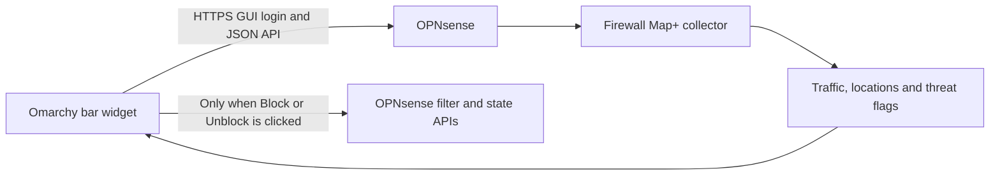
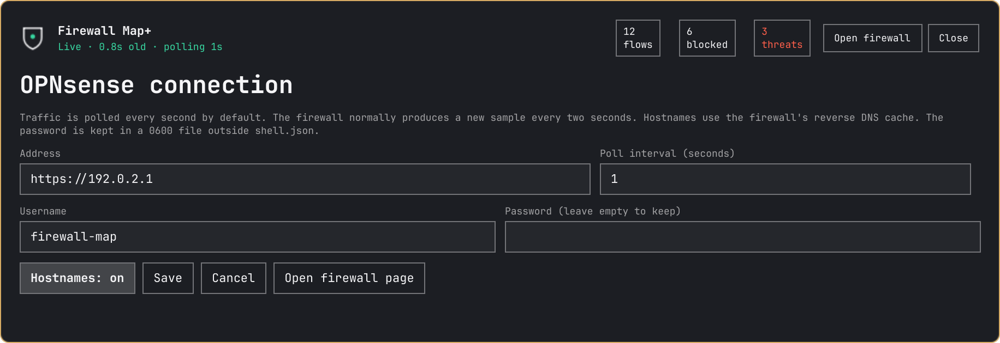

# Requirements and OPNsense setup

## How the pieces fit together



Install the desktop widget on your **Omarchy computer**. Install the separately
maintained **`os-firewall-map` package on OPNsense**. A plain OPNsense installation
without that module does not provide the traffic-summary endpoint this widget uses.

## 1. Prepare OPNsense

Follow the module author's [current installation instructions](https://github.com/claudioguareschi/opnsense-dashboard-plus#install)
to add its package repository, then install **`os-firewall-map`** through
**System → Firmware → Plugins**. Dashboard Plus's other widget packages are not
required for this integration.

Open **Reporting → Firewall Map → Map** (`/ui/firewallmap`). Before configuring
the Omarchy widget, confirm that this page already shows your firewall's location
and current traffic. Check **Status** if its collector or geolocation data is
unavailable. Use an OPNsense release supported by the module's current package.

Useful optional configuration belongs on OPNsense:

- Geolocation provider and WAN/manual firewall location.
- MaxMind GeoLite2 credentials for more precise locations, if desired.
- Threat feeds and an optional AbuseIPDB key for threat flags.
- Firewall rule logging for blocked-source evidence.

CrowdSec and Suricata are not desktop-widget prerequisites. See the upstream
[Firewall Map+ documentation](https://github.com/claudioguareschi/opnsense-dashboard-plus#firewall-map)
for their optional integrations.

## 2. Give an account the required access

The bridge uses an OPNsense **web GUI session**, authenticating with username
and password. It does not use the OPNsense API key/secret authentication scheme.
An interactive MFA challenge cannot be completed by this bridge.

For viewing, the account needs the upstream privilege **Dashboard: Firewall Map
widget**, which covers `api/firewallmap/flow/*` and the map page. Configure user
or group privileges in OPNsense's access settings. Verify the same account can
open `/ui/firewallmap` successfully.

For persistent host blocking, that account additionally needs the permissions
which authorize the following API actions on your OPNsense version:

| Purpose | Endpoint |
| --- | --- |
| List widget-managed rules | `/api/firewall/filter/search_rule` |
| Create, enable and remove rules | `/api/firewall/filter/add_rule`, `/set_rule/<uuid>`, `/del_rule/<uuid>` |
| Apply rule changes | `/api/firewall/filter/apply` |
| Close an IP's existing states | `/api/diagnostics/firewall/kill_states` |

The abbreviated rule paths above share the `/api/firewall/filter` prefix.
Privilege names can differ between OPNsense versions; check their matching API
patterns rather than assuming that map-view access also permits rule changes.
Use an account whose permissions match the features you intend to use.

The widget can continue displaying traffic when rule access is unavailable.
It reports the refusal and disables the row controls. Failed writes are not
automatically replayed. Its rules are persistent, so review the README's
[blocking behavior](../README.md#what-block-does) before using those controls.

## 3. Prepare the Omarchy machine

Use an Omarchy release with the native **Quickshell** shell and the
`omarchy plugin add`, `validate`, `update`, `disable` and `remove` commands.
The published plugin was validated on Omarchy **4.5.0rc3**; compatibility with
older Waybar-only desktops is not claimed.

Local runtime dependencies are `python` (invoked as `python3`), `iproute2`
(the `ip` command), and Omarchy's own Qt/Quickshell UI modules. `git` is needed
to install/update the repository. Python uses only its standard library.
If Python, Git or iproute2 is missing, install the corresponding Arch packages
through your usual package-management workflow before enabling the widget.

The computer must reach the OPNsense GUI address and port over HTTPS. A working
VPN connection is sufficient. Keep the management interface on your trusted
network or VPN; the widget does not need it exposed to the public internet.

## 4. Install and connect

```bash
omarchy plugin add https://github.com/jblparisi/omarchy-firewall-map.git --enable
```

Open the bar widget's **Settings**. Enter the HTTPS base URL, GUI username and
password, then save. The writer creates its state directory and stores a 0600
credential file; no manual credential-file setup is necessary.

Expected result: **Live**, an updating sample age, flow lines and host rows.
The widget asks for traffic once a second by default, but the upstream collector
normally produces a sample at most once every two seconds. Collector ranking
and limits determine which flows are available to display.

If the map works while row actions are unavailable, revisit the filter/state
API permissions. A red threat flag and a successful firewall block are different
states: **Threats** shows flagged current flows, while **Managed blocks** reads
the persistent rules this widget created.


